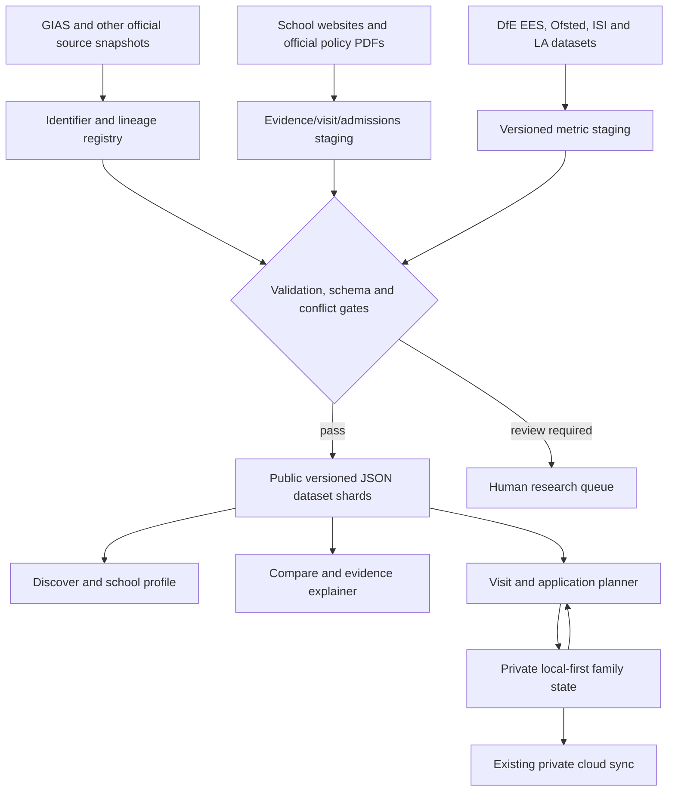

# School Signal vs OpenDay
## Competitor intelligence, data strategy, product design and executable roadmap

> [!IMPORTANT]
> **Research checkpoint — 24 October 2026 (UK).** This is a **strategy and implementation brief, not a claim that features have been built**. The evidence, URLs, source versions and unfinished questions are retained here so subsequent work can resume without redoing the research. All dates and quantities below are observations as of this checkpoint unless stated otherwise. Product names and examples refer to public schools and data only; this document deliberately contains no private child, household or account data.

**Repository:** `nirav2000/Openday` · **Branch:** `main` · **App version inspected:** `2.27.0` (`version.json`; 2026-10-22) · **Competitor:** [School Signal UK](https://www.schoolsignal.co.uk/) (singular domain, not the US schools-communication service).  
**Status:** Research completed for the listed public sources; decisions proposed; implementation, source ingestion, user testing and revenue verification outstanding.

---

## Contents

1. [Executive decision](#1-executive-decision)
2. [School Signal: what it actually offers](#2-school-signal-what-it-actually-offers)
3. [Evidence audit: where apparent comprehensiveness misleads](#3-evidence-audit-where-apparent-comprehensiveness-misleads)
4. [OpenDay today: strengths, weaknesses and opportunities](#4-openday-today-strengths-weaknesses-and-opportunities)
5. [Business, usage, marketing and commercial value](#5-business-usage-marketing-and-commercial-value)
6. [Official and primary data acquisition catalogue](#6-official-and-primary-data-acquisition-catalogue)
7. [Target domain and provenance architecture](#7-target-domain-and-provenance-architecture)
8. [Presentation and interaction system](#8-presentation-and-interaction-system)
9. [Phased delivery plan and backlog](#9-phased-delivery-plan-and-backlog)
10. [Release gates, measurement and quality control](#10-release-gates-measurement-and-quality-control)
11. [Go-to-market and monetisation experiments](#11-go-to-market-and-monetisation-experiments)
12. [Risks and things we should not do](#12-risks-and-things-we-should-not-do)
13. [Handoff: precise next actions and decisions](#13-handoff-precise-next-actions-and-decisions)
14. [Research source register](#14-research-source-register)

---

## 1. Executive decision

> [!TIP]
> **Recommendation: build “the school decision cockpit”, not another national school directory.** School Signal excels at the breadth, discoverability and narrative packaging of national public data. OpenDay has a more defensible opportunity where parents actually need to **verify an eligible entry route, book a visit, remember impressions, understand the numbers, compare viable choices and act before a deadline**.

### Verdict at a glance

| Dimension | School Signal | OpenDay now | Strategic implication |
|:--|:--|:--|:--|
| Geographic scope | Advertises **30,816 UK schools**, all four nations | Curated schools/visits plus a broader local primary radius | Do not expand nationally until local quality and distribution work |
| School profile | One long, richly sectioned public profile; results, demand, staffing, finance, transport, nearby schools, prose | Multiple specialised pages with deep performance, awards, assessments and an enhanced Michaela hub | Introduce a shared, concise summary + progressive school dossier |
| Admissions intelligence | Demand history, free catchment estimates, some authority-published distance figures | Assessments and entry information, but no systematic admissions-rule engine | Highest-value new structured capability, **with no spurious probability scores** |
| Official data | Systematic URN/identifier joins and scheduled national feeds (site claim) | Official DfE pipelines for tracked schools with data-history preservation | Formalise source contracts, freshness checks and data coverage inventory |
| Open-day discovery | Wide public council/date directories | A planning tool with bookings, calendar, notes, event statuses and reminders | Win on **event correctness, entry stage and booking readiness** |
| Results and nuance | Quick comparisons, readable narrative, some warnings on data | Grade 9/9–7, GCSE vs IGCSE exceptions, subject detail, historical archive, calculators | Improve explanatory presentation without sacrificing comparability |
| Ongoing relationship | Free accounts, followed schools, alerts and Pro | Local-first personal views, memorable-token sync, verified corrections and notification infrastructure | Make discovery → appointment → application an unmistakable workflow |
| Distribution | Search-oriented landing pages, knowledge hub, embed for estate agents, newsletters, paid tier and enterprise offers | Primarily an application; limited public acquisition surfaces | Build useful indexed school/event pages and original guides later |

**North-star action:** a parent can move from *“Which schools are plausible?”* to a **verified, personally meaningful shortlist with all relevant visits, admissions conditions, evidence and deadlines**, without searching across several sites.

**Build order (not national expansion first):**

1. **Trust and data freshness:** event entry-stage verification, 2025/26 provisional KS4 + subject-grade import, and dated source badges.
2. **Information architecture:** compelling school summary page and a guided, useful side-by-side comparison.
3. **Admissions intelligence:** actual published priority rules and application/offer context, with an explicit “likelihood cannot be calculated” state.
4. **Planning workflow and distribution:** schedule, alerts, visit questions, applications, and genuinely useful public deep links/SEO.
5. **Scale/monetisation:** only after evidence of retention, correct data and organic demand.

### Three differentiators worth owning

- **“Verified visit.”** A primary/Year 7/11+/13+/sixth-form event must be correctly classified, linked to its official source, with booking status and verification timestamp.
- **“Admissions explained, not guessed.”** Official oversubscription criteria, genuine eligibility and priority, place-demand history, and policy-cycle differences. No green “very likely” for random lotteries.
- **“Numbers with context.”** An 80% KS2 score is unintelligible without national/LA benchmark, cohort size, denominator, historical range, intake/selection and source year. Likewise a school's GCSE result can be misleading when IGCSEs are excluded by DfE accountability tables.

---

## 2. School Signal: what it actually offers

### 2.1 Scope and public product proposition

The homepage on 24 October 2026 advertised **30,816 schools** (England 25,666; Scotland 2,430; Wales 1,567; Northern Ireland 1,153), including **2,547 independent schools**, and **28 years** of inspection history. These are **publisher assertions**, not figures independently reconciled against a government master register. See [homepage](https://www.schoolsignal.co.uk/).

The [live open-days index](https://www.schoolsignal.co.uk/open-days) displayed **8,681 upcoming dates when opened for this report**. An earlier indexed/search snapshot showed **15,187**. This variation is an excellent reason to record *observed at*, counts by type and duplicate/error rates rather than repeating an unqualified headline. The website itself asks users to verify dates at the school.

**Surface map:**

| Journey | Observed surface | Our interpretation |
|---|---|---|
| Discover | Postcode, town and local-authority pages; maps, nearby schools and best-of lists | High intent search-landing funnel |
| Evaluate | School profile aggregating inspection, GCSE/KS2, 16–18, demand, staffing, attendance, SEND, finance and transport | Most impressive presentation and completeness layer |
| Understand | Knowledge hub, FAQ and statistical explainers | Reduces friction and attracts informational searches |
| Compare | Saved lists and side-by-side metrics | Converts casual browsing into consideration |
| Apply | Admissions history, estimated proximity likelihood, dates and reminders | Extremely valuable **if** policy semantics are right |
| Visit | Council-based open-day lists and notices | Direct competitor to OpenDay’s entry surface |
| Retain | Free account, followed schools, alerts, monthly insight emails | Repeat engagement and email capture |
| Monetise | Pro, tutoring profiles, school-claim programme, enterprise/API/white-label, estate agent embeds | Consumer + partner distribution, not confirmed revenue |

### 2.2 Why the presentation feels better

School Signal does five useful things that our older, page-oriented UI can learn from.

1. **Tells a story before showing tables.** A profile explains an Attainment 8 figure in ordinary language and compares it with the council and England.
2. **Places decisions beside facts.** “Applications close in 8 days” is more actionable than a detached admissions dataset.
3. **Uses progressive disclosure.** A first-screen school summary leads to results, admission history, demographics, staffing, destination data and deeper explanations.
4. **Links relevant neighbouring schools.** The next comparison is one click away; users need not rebuild their search.
5. **Makes individual school pages discoverable.** Search engines can find school-specific public information, unlike an app experience that depends on complex client-side filters.

The impression of quality partly comes from **information hierarchy, whitespace, readable typography, consistent cards, selective visual emphasis and strong in-context links**—not primarily from adding more chart libraries. OpenDay can implement these principles with a shared CSS/component system.

### 2.3 School profile exemplar

The [Michaela profile](https://www.schoolsignal.co.uk/school/michaela-community-school-140862), viewed on the research date, contains: a summary, urgent application information, last graded inspection and more recent inspections, headline attainment, local comparisons, historical demand, published distance data, pupil destinations, census mix, teacher ratios, nearby transport, suspensions, absence trends, funding, subject entries, school-sourced quotations/news and Q&A. It is an instructive *content hierarchy*, not necessarily a trustworthy answer to each admissions or qualification question.

### 2.4 What not to copy uncritically

- **Estimated catchment distance as admissions probability:** it can be unfit for lotteries, selective or faith routes. A disclaimer is not a substitute for choosing an appropriate algorithm.
- **Composite “best schools” rankings:** reinforce selection effects, cohort uncertainty and metric mismatches. Source-led comparisons and user preferences are more honest.
- **An oversized dossier with repeated data:** the example profile repeats some subjects/grades across years; parents may not see what year each row represents.
- **Numerical false precision:** e.g., raw absence percentages rendered with several unnecessary decimal places.
- **Whole-school vacant capacity as available Year 7 places:** these are fundamentally different quantities.
- **An undifferentiated “secondary open evening”:** Sixth Form events must not masquerade as Year 7 events.

---

## 3. Evidence audit: where apparent comprehensiveness misleads

These are **targeted examples**, not a statistically representative accuracy study. Reproduce the sampling method on at least 25 locally relevant events and 20 school profiles before making a general competitor-quality claim.

### Case A — Pinner High: correct date, wrong entry stage

**School Signal:** [Harrow open-days listing](https://www.schoolsignal.co.uk/open-days/harrow) displays **Thursday 12 November 2026** as an “Open evening” for Pinner High, categorised simply as **Secondary**. A parent browsing for a Year 7 admission visit could mistake it for the relevant event.

**Primary source:** [Pinner High, Apply to study with us](https://www.pinnerhighschool.org/sixth-form/apply-to-study-with-us/) explicitly calls **12 November 2026, 5–7pm** its **Sixth Form Open Evening**, including arrangements for external students. It is not the same as the Year 7 admissions visit.

**OpenDay rule:** event identity must contain `schoolId + entryRoute + cycle + eventType + date`, and an event displayed in a Year 7 view must have `entryRoute=year7`, not merely a school with `phase=secondary`. For contradictory source evidence: quarantine and notify for review, never silently accept.

**Acceptance example:** searching Year 7 visits never shows this Sixth Form evening; viewing Pinner High all events can show it with a clear “Sixth Form” label and verified source.

### Case B — Michaela: a lottery is not a distance-ranked catchment

**School Signal:** [Michaela school page](https://www.schoolsignal.co.uk/school/michaela-community-school-140862) advertises proximity bands **“Very likely ~1.3 km / Possible ~1.9 km / Unlikely ~2.4 km”** with “medium” confidence, and the [admissions-history page](https://www.schoolsignal.co.uk/school/michaela-community-school-140862/admissions) quotes a **6,532m** last-offer distance for 2026.

**Admissions evidence:** the school's published [2025/26 admissions policy PDF](https://michaela.education/wp-content/uploads/2026/03/Admissions-Policy-202526-incY12.pdf) describes a **five-mile eligibility radius and random allocation** among eligible applicants after defined higher priorities; beyond that, distance has a different role. **Verify the determined 2027/28 policy before advising an applicant to use those rules today**. The School Signal bands are a general neighbourhood model, not a school-specific lottery probability.

**OpenDay rule:** an admissions policy is an explicit **dated entry-route decision tree**, not a generic postcode-to-distance model. Show `"Eligible for five-mile ballot subject to priority rules"` if the determined policy supports it; show `"Chance unknown—random allocation"` rather than “very likely”. Distinguish first-preference demand, PAN, *national-offer-day offers* and whole-school capacity. A reported last distance does not become a deterministic cutoff when places are allotted randomly.

**Acceptance example:** the Michaela Year 7 profile never generates a distance-based certainty badge, and every route cites the applicable admissions-policy year.

### Case C — years, qualifiers and units must remain attached

The Michaela profile interleaves **2025 GCSE headline results**, **2024 Progress 8**, **2025/26 subject entry commentary**, older inspection judgements and **2026 admissions data**; some subject-entry listings appear repeated across multiple years, and summary prose uses a percent symbol for an Attainment 8 *score*. A parent can easily read visually adjacent figures as contemporaneous or as percentages.

**OpenDay rule:** each metric visibly carries **value + unit + academic year + population/denominator + source + status**. A secondary outcomes panel should explicitly read `"Attainment 8: 77.6 points · 2024/25 · DfE"`, not `"77.6%"`. State why Progress 8 is not available in 2024/25 or 2025/26, rather than leaving a mysterious dash. For combined-science double awards, document entry vs grade-award denominator, and for GCSE/IGCSE, expose excluded coverage.

### Case D — quality benchmark to run later

Sample **25 public open-day records** (cover Reception, Year 7, Year 12, grammar, independent, events marked TBC) and **20 school profiles** from Harrow/Brent/Barnet/Hillingdon and independent comparators. For each, record:

- Correct school identity, entry phase, event date/time, booking URL and official proof?
- Correct latest-year headline, units, result cohort, missing/suppressed data?
- Correct admissions-rule type (distance, catchment polygon, ballot, tests, faith, sibling, sibling-after-random, etc.)?
- Latest report vs legacy Ofsted grade clearly distinguished?
- Reproducible count of errors per 100 records; severity `S0 legal/application` / `S1 wrong visit` / `S2 stale figure` / `S3 cosmetic`?

Store only observations and school-public links. Do not scrape or bulk-download School Signal; its [terms](https://www.schoolsignal.co.uk/terms) expressly prohibit this. Manual targeted QA of publicly visible pages plus **independent upstream official data ingestion** is the appropriate approach.

---

## 4. OpenDay today: strengths, weaknesses and opportunities

### 4.1 What already exists — do not rebuild blindly

Checked against the public [OpenDay repository](https://github.com/nirav2000/Openday), `AGENTS.md`, `README.md`, `version.json`, `ARCHITECTURE_SIMPLIFICATION.md` and existing data/workflows on `main`.

| Existing capability | Important source or area | Preserve / improve |
|---|---|---|
| Visit events, upcoming/TBC, calendars | `data/schools.json`, `data/primary-schools.json`, `calendar.ics` | Preserve booking/event identity; add structured entry stage and evidence |
| Private shortlists, visited, notes, opinions, merges | Application state and Firebase token adapter | Retain local-first and lossless three-way merge; never expose to public SEO |
| 11+/13+ assessments and papers | `data/assessments.json`, `data/assessment-resources.json` | Make route-specific and cross-link to applications |
| Scholarships and bursaries | `data/scholarships.json`, `data/bursaries.json` | Expand explanatory comparisons, dates, evidence and eligibility |
| GCSE/A-level, cohorts, grade 9/9–7 | `data/performance.json`, `data/school-results-archive.json` | Integrate 2025/26 provisional; retain all historical measures |
| KS2, contextual cohorts | `data/primary-performance.json`, `data/primary-cohort-context.json` | Explain national reference points, small-cohort effects and intake |
| Configurable performance table | `performance.html`, associated JS/CSS | Keep power-user table; add a friendly decision summary above it |
| Measures/APS calculators | `measures.html` | Link as contextual learning, not bury in a separate tool |
| Michaela dossier | `schools/michaela/` | Use as a pilot pattern for other school dossiers |
| Notifications and booking-watch infrastructure | Existing app notification and shared integration modules | Extend carefully and with user consent |
| Shared validation, Version Lab, monitoring | `validation.config.json`; `nirav2000/Apps/validation/` | Reuse as hard release constraints |

**Repository reality:** `version.json` reports **2.27.0** on 22 October 2026; the `README.md` opening still says **2.23.0**, so source-of-truth alignment itself should be checked in a later documentation hygiene pass.

### 4.2 Most important verified data freshness gap

**15 October 2026:** DfE released **2025/26 provisional school-level KS4 figures** and **school-level subject grade counts**. The currently documented OpenDay pipeline describes 2024/25 as its latest institution dataset. The next work should **inspect what is actually present in the currently deployed JSON**, then import 2025/26 if absent; do not assume README is infallible.

Direct official dataset pages:

- [2025/26 school-level KS4 performance](https://explore-education-statistics.service.gov.uk/data-catalogue/data-set/bf138f04-daa2-4759-b950-937a17a4c675), API dataset ID `19e39901-a96c-be76-b9c2-6af54ae076d2`.
- [2025/26 subject entries and grades (undiscounted)](https://explore-education-statistics.service.gov.uk/data-catalogue/data-set/5278712e-8e5a-4868-96be-4cd03ef66bdb), API dataset ID `1ae39901-b462-df76-b108-640a078d7944`.
- [2025/26 release overview](https://explore-education-statistics.service.gov.uk/find-statistics/key-stage-4-performance/2025-26): **provisional** now, revised release expected **February 2027**.
- **Progress 8 is not calculated for either 2024/25 or 2025/26**, because of disrupted prior-attainment baselines.

**Primary timing is different:** DfE's 2025/26 provisional KS2 release (10 September 2026) gives aggregate statistics but **school-level results are due in December 2026**. Do not fabricate individual 2026 KS2 scores now. The published England benchmark for 2026: **63% combined expected standard and 9% combined higher standard**; use explicitly as *national, provisional, cohort 2026*, not a “good school threshold”. See [2026 KS2 provisional](https://explore-education-statistics.service.gov.uk/find-statistics/key-stage-2-attainment/2025-26-provisional).

### 4.3 Gaps ranked by expected user benefit

| Rank | Gap | Why it matters | Initial solution |
|---:|:--|:--|:--|
| 1 | Visit stage and verification | Missing a Year 7 place or attending Sixth Form by mistake has direct cost | `EntryRoute` and `VisitEvent` source/status |
| 2 | School-level admissions rules | Families need *eligible + realistic*, not a generic circle | School-specific versioned policy and an honest “unknown probability” |
| 3 | 2026 GCSE freshness | Newest results already public | Non-destructive DfE provisional + subject import |
| 4 | Friendly school profile | Current power-user tables overwhelm less technical parents | One school, one summary, progressive details |
| 5 | Benchmark context | “80%” lacks meaning in isolation | Cohort and matched national/LA/context/range labels |
| 6 | Demand/offers | Popularity and offers differ from admission chance | Official 2026 school-level preference file with caveats |
| 7 | Routes and costs | Feasibility affects real choice | Estimated commute with method, refresh and opt-in postcode |
| 8 | Organic discoverability | Valuable information hidden inside app workflow | Static indexed public dossier/event URLs |
| 9 | Cross-school UX consistency | Visual improvements shouldn't require six page rewrites | Shared tokens, components and regression screenshots |
| 10 | National breadth | Useful later, but accelerates staleness today | Pilot locally, expand with measurable quality gates |

---

## 5. Business, usage, marketing and commercial value

### 5.1 What we can verify

| Area | Public evidence | Interpretation and confidence |
|---|---|---|
| Operator | [About page](https://www.schoolsignal.co.uk/about) names founder **Alexis Pratsides** and trading entity **KK London (Designs & Fashion) Limited**, company no. **12968488** | **High** for public self-identification; not evidence of product launch date or annual sales |
| Corporate registration | [Companies House register](https://find-and-update.company-information.service.gov.uk/company/12968488) | Confirms corporate record; registered company can operate other business activities |
| Consumer offer | [Pricing](https://www.schoolsignal.co.uk/pricing): free profiles and comparisons, **Pro £9/month including VAT**; annual option advertised at 17% off | **High** that it is a price offered; **no inference** about subscriber count |
| Enterprise | API/white-label/MAT/local-authority/estate-agent propositions advertised | **Offer exists**, contracts/revenue unverified |
| Distribution mechanism | [Free embeddable estate-agent widget](https://www.schoolsignal.co.uk/for-estate-agents), site postcode pages, local-authority directories | **Real product mechanism**; partner uptake unknown |
| Editorial SEO | [Knowledge Hub](https://www.schoolsignal.co.uk/knowledge-hub), 44 topic guides as currently advertised (10+10+10+5+4+5), statistics pages | Content supply is visible; visits/rankings unknown |
| Retention | Save/alerts, newsletters and application deadline reminders | Product funnel visible; monthly active usage and retention unknown |
| Traffic instrumentation | Google Tag Manager embed present on public pages | Instrumentation exists; **cannot reveal** visitors, acquisition, conversion, paid media spending |
| User satisfaction | Claims and site UX | No reliable independent conversion, NPS, retention or broad review sample established during this review |

### 5.2 **Unknown is not zero**

We **cannot verify** School Signal's unique monthly users, traffic, organic vs paid share, conversion to Pro, Pro churn, ARPU, B2B licences, revenue, profitability, acquisition cost, app-install count, active subscriptions or sale valuation from the pages reviewed. A website's count of indexed school records or open-day entries is **inventory**, not **audience**.

**How to research further without inventing figures:**

1. **Search visibility:** Ahrefs/Semrush/Similarweb directional estimates **if available**; check coverage, sample size and low-traffic blind spots. Do not present as audited traffic.
2. **Index footprint:** Google/Bing `site:` sampling by school/postcode, number of useful non-duplicate public routes, search snippet quality; not equivalent to search impressions.
3. **Market response:** dated third-party articles, real reviews, public partnerships and publicly attributable links. Separate promotional pieces from independent evidence.
4. **Commercial:** Companies House filed accounts and confirmation statements; small-company accounts may not disclose turnover. Cross-reference the correct trading entity and period.
5. **Competitor observability limit:** actual analytics, payments and conversion funnel require the owner’s consent/access. Use an evidence table rather than invented MAUs.

### 5.3 Illustrative economics — **not School Signal revenue**

Assuming **all** users pay £9/month including VAT, ignoring trials, annual plan discounts, refunds, fees, customer acquisition and churn:

| Hypothetical paying monthly accounts | Gross subscription receipts/month (VAT included) | Annualised gross receipts |
|---:|---:|---:|
| 50 | £450 | £5,400 |
| 250 | £2,250 | £27,000 |
| 1,000 | £9,000 | £108,000 |
| 5,000 | £45,000 | £540,000 |

At a *hypothetical* 20% VAT rate, net-of-VAT monthly receipts would be gross divided by 1.2, **not profit**. These are deliberately scenarios, **not forecasts**, not ARR evidence and not a valuation. If typical school-choice use lasts 3 rather than 12 months, subscription lifetime value differs dramatically, making a low-CAC organic funnel and recurring B2B licensing potentially more important than subscription price.

**What determines value for an acquirer:** verified recurring revenue, churn/retention, gross margin after data processing and support, traffic concentration, search dependence, defensibility of IP, contracts, customer data rights, licences and founder dependence. Public-sector source aggregation is replicable; proprietary joins/quality systems, trust and reliable distribution can become a moat.

### 5.4 Marketing decomposition

`Search question → local landing page → school profile → shortlist/alerts → return visit → Pro/partner sale`

- **Programmatic SEO:** many individual URN-linked school pages, towns, counties, admissions histories and “best” pages. Requires actual unique answers, not hundreds of thin templates.
- **Topical authority:** explainers on results, admissions, Ofsted and SEND, plus annual statistics posts. Individual pages link back into profiles.
- **Timely hooks:** school deadline countdowns and “latest inspections”, refreshed from authoritative sources.
- **Email capture:** useful change alerts/free accounts and monthly insights, not just a newsletter box.
- **Referral and distribution:** free estate-agent property widget can place a link or brand in a completely different purchase journey.
- **Supply side:** schools can claim public profiles, tutors advertise profiles, enterprise data product can monetize professional usage.

**Observed product marketing ≠ proven marketing performance.** No ad spend, SEO revenue or paying customer volumes are inferred.

### 5.5 Business positioning choice for OpenDay

Free public evidence + excellent planning could justify **consumer subscriptions** for family collaboration, tailored deadline packs, complex transport scenarios and exports. But gating basic admissions rules, unverified “chance” estimates or legally required dates would create distrust.

A more durable potential model is **free families + paid white-label school-selection tools for relocation advisers, education consultants or school advisers**, with transparent sponsorship separation. Do not allow schools to buy favourable rankings. Test first; no monetisation is authorised by this report.

---

## 6. Official and primary data acquisition catalogue

> [!NOTE]
> Data feeds must be consumed from **original licensed authorities** or the **schools' own lawful public publications**, **never from scraping School Signal**. Confirm licence and reuse terms **for each actual dataset**; an Open Government Licence statement on an aggregator's site is not a licence for their authored material or design. “Cadence” is a monitoring suggestion and may differ from the publisher's update cycle.

| Priority | Domain / owner | Concrete upstream source | Data / join | Proposed check | Caveats |
|:--:|:--|:--|:--|:--|:--|
| P0 | Master establishments | [DfE GIAS](https://get-information-schools.service.gov.uk/) | URN, establishment number, phase, trust, status, address, website | Daily | Historical URNs/reconstitutions and schools with several campuses; non-English identifiers differ |
| P0 | 2026 GCSE headline | [DfE KS4 school-level 2025/26](https://explore-education-statistics.service.gov.uk/data-catalogue/data-set/bf138f04-daa2-4759-b950-937a17a4c675) | URN/LAEstab + year, A8, grade 5+ and breakdown | After releases; weekly discovery | **Provisional** now; **revised Feb 2027**; 2024/25+ Progress 8 unavailable |
| P0 | 2026 GCSE subjects | [DfE KS4 school-level subject grades](https://explore-education-statistics.service.gov.uk/data-catalogue/data-set/5278712e-8e5a-4868-96be-4cd03ef66bdb) | Grade entries, subjects, year, denominator | After releases | **Undiscounted**, may count qualifications not unique children; IGCSE/reporting coverage |
| P0 | School visits | Individual official school events/admissions pages | Entry stage, event type, time, booking, official URL and evidence text | Daily on selected 50, weekly otherwise | HTML changes, invitation-only visits, stale cached pages, different stages |
| P0 | Admissions arrangements | Determined admissions policies published by each school/LA; LA 2027 admissions booklets | Priority categories, geographical rules, random ballots, test/faith criteria, PAN, cycle | Per admissions cycle, on policy change | No generic proxy for eligibility or likelihood |
| P0 | Offer pressure/history | [DfE 2026 school-level applications/offers CSV](https://explore-education-statistics.service.gov.uk/find-statistics/primary-and-secondary-school-applications-and-offers/2026-27/explore) | School LAEstab, preferences by rank, national offer day offers | Annual | **67 MB CSV**; not actual odds, offer criteria absent, dummy LAEstab edge cases |
| P1 | Primary outcomes | [DfE KS2 revised/provisional](https://explore-education-statistics.service.gov.uk/find-statistics/key-stage-2-attainment/2025-26-provisional) | Year, eligible pupils, R/W/M expected and higher, scaled scores | Annual | **2026 school-level not due until Dec 2026**; provisional 2026 is aggregate |
| P1 | School inspections | [Ofsted monthly latest inspections](https://www.gov.uk/government/statistical-data-sets/monthly-management-information-ofsteds-school-inspections-outcomes) | School URN, publication date, historical grade/report-card areas | Monthly + new-report check | Latest inspected vs *graded* distinction; report cards new framework |
| P1 | Independent inspections | [Independent Schools Inspectorate](https://www.isi.net/reports/) and independent school regulator publications | Reports, dates, report scope | Monthly | No false equivalence with Ofsted |
| P1 | 16–18 results | [DfE Explore Education Statistics](https://explore-education-statistics.service.gov.uk/) 16–18 releases | A levels/academic qualifications, cohort, destinations, subjects | On release | Sixth form vs school may have separate institution IDs |
| P1 | School published GCSE/IGCSE | Official independent-school results PDF/HTML pages | GCSE/IGCSE subject entries, grade distributions, academic year | Annual | Manual audit, specific qualification coverage; don't copy copyrighted prose |
| P1 | Student destinations | [DfE destination measures](https://www.gov.uk/government/publications/progress-8-school-performance-measure/secondary-accountability-measures-2025-guidance-for-maintained-secondary-schools-academies-and-free-schools) | Sustained Year 11/16–18 destinations, cohorts/denominators | Annual | Reporting is lagged; independent schools often excluded; no individual alumni tracing |
| P1 | Absence | [DfE school absence](https://explore-education-statistics.service.gov.uk/find-statistics/pupil-absence-in-schools-in-england) | Overall, persistent, severe, authorised/unauthorised | Termly/full-year | Different school cohorts, small denominators; no simplistic causal inference |
| P1 | SEN/FSM/EAL/cohort | DfE school census and SEND data via [EES](https://explore-education-statistics.service.gov.uk/) | Pupil proportions, SEND categories, EAL, FSM, denominator | Annual | Context is not a school-quality score; suppression/privacy |
| P1 | School size/capacity | [DfE School Capacity release](https://explore-education-statistics.service.gov.uk/methodology/school-capacity) | Capacity, pupils, forecasts and planned provision | Annual | **Whole-school vacant places ≠ available Reception/Year 7 places** |
| P2 | Workforce | DfE [EES](https://explore-education-statistics.service.gov.uk/) school workforce | Teacher FTE, pupil/teacher ratio, staffing | Annual | FTE vs headcount; year mismatch |
| P2 | Finance | DfE [school financial benchmarking](https://schools-financial-benchmarking.service.gov.uk/) and published allocations | Spend, funding per pupil, year | Annual | Categorical accounting differences; independent-school exclusions |
| P2 | Transit | [NaPTAN open transport data](https://beta-naptan.dft.gov.uk/), licensed routing service | Nearby stops and walking links | Monthly | Straight-line stop distance is not a reliable commute |
| P2 | Postcodes/maps | [ONS Open Geography Portal](https://geoportal.statistics.gov.uk/), OS open data and geocoding | Postcode centroids, areas and boundaries | On release | Public postcode centroids are approximate; home address stays private |
| P2 | House prices | [HM Land Registry Price Paid](https://www.gov.uk/government/statistical-data-sets/price-paid-data-downloads) | Completed property transactions | Quarterly | Transactions not live prices; address privacy, inflation and mix effects |
| P3 | Different UK education systems | Wales [My Local School](https://mylocalschool.gov.wales/), Scotland [school education statistics](https://www.gov.scot/), Northern Ireland [education statistics](https://www.education-ni.gov.uk/) | Jurisdiction-specific inspection, attainment and census | Release-based | **Never compare four-nation grades in a single synthetic league table** |

**Access method / EES:** see [official statistics API CSV guide](https://api.education.gov.uk/statistics/docs/getting-started/how-to-get-csv-data/) for supported dataset IDs and CSV retrieval. Snapshot datasets by **dataset ID, version, release, downloaded timestamp and source hash**. Prefer API for supported datasets; use official downloadable ZIP/CSV when no API is offered. Every import must retain source conventions (`z` not applicable, suppressed codes, not available) **as metadata**, never silently coerce to zero.

**No substitute for local authority policy:** the official [2026 school application/offers methodology](https://explore-education-statistics.service.gov.uk/methodology/primary-and-secondary-school-applications-and-offers) specifically states that the reasons/criteria for allocating places are not in that dataset. Its school file can contain dummy codes or codes which do not join neatly to current GIAS. Build reviewed aliases and quarantine ambiguous joins.

### Source contract and refresh intelligence

`SourceRegistry` should record: publisher, official URL, licence and attribution, access method, version and release, expected cadence, next expected event, geographic coverage, join key, suppressed-value semantics, last fetch, last successful ingest, raw checksum, reviewer and known breaks.

Each key event deserves a **release watch**:
- KS4 2025/26 provisional available **15 Oct 2026** → import after QA; replace *latest pointer* on revised release **Feb 2027**, **not** the historical record.
- KS2 2025/26 school-level expected **Dec 2026** → set a scheduled watch, **do not promise school figures earlier**.
- 2027 Reception/Year 7 admissions cycles → discover each official determined policy and open events before parents need to book.
- Ofsted Sept 2026 management information released **16 Oct 2026**, with next monthly updates scheduled.

---

## 7. Target domain and provenance architecture

### 7.1 Treat these as different things

`School` is the official establishment. `EntryRoute` is the admissions route into a year or section of that establishment. `VisitEvent` is a particular visit for that route. `ApplicationCycle` is a named entry year and sequence of deadlines. `MetricObservation` is a dated sourced fact. `PolicyRule` is a particular admissions-rule version. `PrivateDecision` is family-only data.

Do **not** infer any of them from an event card title or school name.



### 7.2 Reference shape (illustrative target, **not** an applied migration)

```json
{
  "school": {
    "id": "school:140862",
    "jurisdiction": "England",
    "urn": "140862",
    "status": "open",
    "name": "Michaela Community School",
    "identityHistory": []
  },
  "entryRoute": {
    "id": "school:140862:year7:2027",
    "schoolId": "school:140862",
    "entryPoint": "Year 7",
    "entryYear": 2027,
    "policyYear": "2027/28",
    "admissionsScheme": "random_allocation",
    "eligibilityModelStatus": "policy_requires_review",
    "probabilityStatus": "not_estimable",
    "ruleEvidenceIds": []
  },
  "visitEvent": {
    "id": "visit:example-placeholder",
    "schoolId": "school:140862",
    "entryRouteId": "school:140862:year7:2027",
    "type": "open_evening",
    "start": null,
    "timezone": "Europe/London",
    "bookingStatus": "unknown",
    "verificationStatus": "unverified",
    "sourceEvidenceIds": []
  },
  "metricObservation": {
    "schoolId": "school:140862",
    "metric": "attainment8",
    "value": null,
    "unit": "points",
    "academicYear": "2025/26",
    "releaseStatus": "provisional",
    "population": "KS4 eligible cohort",
    "denominator": null,
    "missingReason": "not_yet_imported",
    "sourceEvidenceId": "dfe-ks4-202526"
  }
}
```

**The `null` values above are intentionally examples, not Michaela's actual 2026 results or scheduled visit. Do not seed them as real observations.**

### 7.3 Every public numeric fact must carry provenance

| Field | Why |
|---|---|
| `schoolId` / `identifierAtSource` / `lineage` | URNs change on academisation, merger, split; do not join on names alone |
| `metricId` / `unit` / `qualifier` | Points, percentages, counts, grade awards, entries and pupils must never be mixed |
| `academicYear` / `cycleYear` / `cohort` / `denominator` | Comparability, sample size and “when?” |
| `sourceUrl` / `publisher` / `sourceRelease` / `sourceHash` | Reproducibility |
| `publishedAt` / `retrievedAt` / `verifiedAt` / `nextReviewAt` | Freshness and correction handling |
| `evidenceStatus` | Official / school-published / derived / manually verified / needs-review |
| `comparabilityStatus` | Comparable / limited / missing / suppressed / not applicable |
| `coverage` / `countingMethod` | GCSE vs IGCSE and entry vs pupil distinctions |
| `revisionOf` | Append corrections rather than rewriting previously observed publications |

**Strong invariants:**
- A result of `0` is not the same as *missing*, `z` not applicable, suppressed, not in DfE accountability or zero qualifying entries.
- One school can have three visit events and two entry stages on the same date.
- A programme's `publishedAdmissionsNumber` is not  `totalSchoolCapacity - currentRoll`.
- A proximity model must not silently masquerade as official eligibility or a probability.
- England's legacy Ofsted overall grade and newer report-card dimensions have different schemas and must retain inspection dates.
- Stage-sensitive events need an applicability field, e.g., `reception` / `year7` / `year12` / `11plus` / `13plus` / `all_prospective` / `unknown`.

### 7.4 Preserve architecture and privacy

Current [OpenDay simplification plan](https://github.com/nirav2000/Openday/blob/main/ARCHITECTURE_SIMPLIFICATION.md) explicitly warns that major UI, event identity, migration and cloud sync changes should **not** ship together. Follow that order: freeze fixtures → introduce pure data schema → stage new public data → add UI → only later refactor private state if justified.

Public school data should be **immutable build-time/static JSON** (potentially lazy-loaded by geography and domain). Keep **local-first decisions and user addresses out of public pages and URLs**. The existing Firebase token sync and merged private notes are not to be reset or copied into a public research cache.

---

## 8. Presentation and interaction system

### 8.1 An overall information architecture

**Global nav, 5 tasks:** `Discover` · `Compare` · `Visits` · `My shortlist` · `Learn`. Profile and application route pages are deep-linkable children. Keep the existing separate powerful `Performance` table and `Measures` calculators under `Compare` / `Learn` rather than deleting them.

**Page 1 — Discover**

- Search town, postcode or school; immediate as-you-type filtering, clear button, relevant saved preferences; no broken result clicks.
- Primary filters: **Entry stage** (Reception/Year 7/Year 12), **travel feasibility**, **type**, **admissions type** and **event availability**. School type is not a proxy for event entry stage.
- Two tabs: `Schools` and `Visit events`. A map is optional; list must work independently and on iPhone.
- Every result shows two meaningful numbers with year, actual event dates, verified source and next decision.
- Local area pages have a useful no-login landing experience; no precise-address publication.

**Page 2 — School dossier**

```text
SCHOOL NAME                     Saved ♡   Compare □
TYPE · PHASE · AREA · ENTRY STAGES · Official website
────────────────────────────────────────────────────
[2025/26 GCSE: points and grade 9–7   PROVISIONAL]
[2026 offers: demand context] [Latest inspection: date]
[Next verified Year 7 event: date / booking link]
────────────────────────────────────────────────────
Can I apply?    Policy type / eligibility / unknowns
Can I visit?    Dates, source, booking and reminders
What is it like? Academic + arts + pastoral + daily life
What do the numbers mean? Year, matched benchmark, cohorts
My verdict      Private notes and visit answers
────────────────────────────────────────────────────
Details: Results | Admissions | Life | Context | Inspections
         Fees/Awards | Journey | Evidence/history
```

**Card principle:** lead with the parent's decision; one headline, one context sentence, one next action. Never show 20 tiny “good/green” badges. Useful status chips are `Official`, `School published`, `Derived estimate` and `Needs verification` with accessible text, not colour alone.

**Page 3 — Compare**

- Select up to four schools. Sticky school names; scrollable on mobile with deliberate visible “columns”.
- One row per **question**: entry viable?, effort to apply?, visit availability?, GCSE Grade 9/9–7?, KS2 expected/higher?, subject strengths?, arts/music/D&T/sports?, fee/bursary?, travel?, cohort size?, user impression?.
- Each figure shows year and compact source link. Support “comparable only” and show *why not comparable* instead of zero.
- User-controlled importance weights are **personal preferences**, never a public “objective school rank”. If composite private scoring exists, explain inputs and abstain for unmeasured values.
- Offer `Print/share private family comparison` only through an intentional export with privacy warning; never index.

**Page 4 — Visits / application planner**

- Calendar and chronological list driven by the same `VisitEvent` source.
- Explicit `Upcoming / Booking open / Booking unavailable / Fully booked / TBC / Expired`, plus `Reception / Year 7 / Sixth Form`.
- Countdown to *booking availability* and *application deadline*, not only visit date.
- School-specific questions, answers and follow-up links. Private notes save locally, sync deliberately and preserve conflicts.
- Calendar invites/link and post-visit check-in.
- A separate “I want to know when booking opens” watch should only notify with proper opt-in and verified publisher source.

**Page 5 — Learn**

- Specific explainers with real school examples and links to official definitions: KS2 scaled scores and higher standard, small cohorts, Progress 8, Attainment 8, EBacc APS, GCSE vs IGCSE, subject combinations, selective tests, lotteries, offered-distance myths and admissions preference ranking.
- Link directly from the metric label or comparison caveat to the relevant explainer; avoid jargon popovers that do not answer a parent’s question.

### 8.2 Make metrics interpretable

For a fictional Year 6 school with **80% combined expected standard**:

> **80% met the expected standard in reading, writing and maths.** National comparison: **63% in England's 2026 provisional data**—a difference of **+17 percentage points**, not +17%. **However**, the school's score must use the *same year* before the difference is presented as a valid comparison. If its 80% came from **2024/25**, use the corresponding **2025** benchmark instead. Show `number eligible`, source and three-year variability. Explain that a small Year 6 cohort can move percentages substantially when one pupil changes the numerator.

Use histograms/benchmarks only with matched year, phase and qualification; show spread/distribution when available. Do not imply selected GCSE outcomes measure school causal effect. A selective school's high results, age/sex composition and school admissions are separate facts.

### 8.3 Shared visual design system

Create **semantic design tokens**, not a page-specific redesign:

| Layer | Standard |
|---|---|
| Typography | Single modern sans family; explicit display/heading/body/metadata scale; 16px body minimum on phone |
| Colour | Neutral backgrounds, controlled one-accent palette, accessible contrasts; colours signal state, not school merit |
| Spacing | Consistent 4/8px rhythm, page max width, readable table densities |
| Cards | 3 families: `SchoolSummary`, `FactWithSource`, `ActionEvent` |
| Data visuals | Reusable matched benchmark bar, historical line, grade distribution, cohort/uncertainty marker |
| Confidence | Two independent concepts: *provenance* vs *modelling confidence*. “Official” may still be historical. |
| Mobile | Real tappable rows, no off-screen detail/action, sticky bottom action only if it does not obstruct content |
| Accessibility | Keyboard navigation, WCAG AA contrasts, focus rings, chart table alternative, reduced motion |
| QA | Shared CSS selectors/tokens, visual snapshots across primary/performance/dossier and phone/tablet/desktop |

**Do not rewrite all old CSS at once**. Build one design-system pilot on School Profile, validate with shared checks, then migrate the Discover list and comparison gradually.

### 8.4 Public page, private overlay

A school dossier must load without login at a stable descriptive URL (e.g., `/schools/140862`). Auth/sync adds optional personal `Saved` / `Visited` / `My view` / `My notes` overlays. Rendering and search engine HTML must **never expose private notes, child details, precise home coordinates or sync capabilities**.

---

## 9. Phased delivery plan and backlog

**Indicative sequencing, not a commitment to elapsed delivery time.** Do not begin work by simultaneously replacing state storage and redesigning the UI. Each wave requires current-main verification and the shared release gate.

### Workstream 0: Baseline and source audit (first)

| ID | Deliverable | Testable completion condition |
|---|---|---|
| `OD-SS-001` | Current source inventory and freshness dashboard | Every tracked school + published dataset has year, last ingestion, missing/suppressed status and source URL; no fabricated 0 |
| `OD-SS-002` | Source admission/event classification test corpus | ≥25 manually checked local event fixtures; includes Pinner High Year 12 example and at least one ballot/faith/selective route |
| `OD-SS-003` | Record existing UI and design tokens | Screenshot baselines on Chromium desktop/mobile + WebKit iPhone/iPad; known broken search/row navigation test added |
| `OD-SS-004` | Current 2026 data presence check | Assert exactly which 2025/26 datasets exist in live/staged JSON; record differences from `README`; create update manifest |

**Exit gate:** audit is reproducible, existing tests green, no private data exposed.

### Workstream 1: Data corrections and provenance (highest impact)

| ID | Delivery | Acceptance criteria |
|---|---|---|
| `OD-SS-101` | Introduce `EntryRoute` and stage-aware `VisitEvent` schema + backwards-compatible mapping | Multiple events/stages per school do not merge incorrectly; old bookmarks and private booking flags intact |
| `OD-SS-102` | Evidence badges / booking review states | Every event displays school source, last verified, stage, booking availability; expired and TBC explicit |
| `OD-SS-103` | Import 2025/26 provisional KS4 headline | Stable school IDs, exact release, provisional labels, source/units, no overwrite of 2023–2025 history |
| `OD-SS-104` | Import 2025/26 subject-grade counts | Correct grade/entry denominator, combined science pairs and GCSE/IGCSE limitations; validate ≥10 representative state and independent schools |
| `OD-SS-105` | Admissions 2026 school preference/offer dataset | Correct LAEstab joins or reviewed exception queue; differentiate preference rank, offers, PAN and whole-school capacity |
| `OD-SS-106` | 2026 primary KS2 release watch | Public data source checked; no school-level values displayed before December release; after release imports school-level with year/revision flags |

**Non-negotiable tests:** earlier exam-year records unchanged; independence/IGCSE coverage flagged; every metric has source and year; Pinner Year 7 list excludes Sixth Form; no unapproved access to live private Firebase in CI.

### Workstream 2: Design and decision UX

| ID | Delivery | Acceptance criteria |
|---|---|---|
| `OD-SS-201` | Shared CSS tokens and UI component contract | At least school summary, event action and provenance fact component reuse same design tokens; no cross-page selector regressions |
| `OD-SS-202` | Reusable public School Dossier pilot (3–5 contrasting schools) | Opening school cards works; summary answers entry, visit, outcomes and fit; sources visible; touch tested |
| `OD-SS-203` | Benchmark explainers and KS2 context | A percentage includes same-year national comparator, cohort/denominator and correct percentage-point semantics |
| `OD-SS-204` | Guided school comparison | Four schools on desktop, phone horizontal affordance, missing/comparability filters, preserved power-user performance table |
| `OD-SS-205` | Admissions rule display (manual pilot) | Versioned policy links for ballot, distance, selective and faith examples; no blanket probability badges |
| `OD-SS-206` | Search/filter interaction hardening | Search updates as typed, clear works, rows/clicks open the selected school, no tappable target occlusion |

**Review gate:** invite 3–5 families using a neutral profile to complete a find → compare → book task. Record time, errors, perceived confidence and whether they spotted stage/policy caveats. No invented market research findings.

### Workstream 3: Deepen local data and the parent workflow

| ID | Delivery | Acceptance criteria |
|---|---|---|
| `OD-SS-301` | Ofsted report-card and legacy-grade history | Report date and framework obvious; new report dimensions not compressed to old grades |
| `OD-SS-302` | Destinations/workforce/SEND/absence context | Each sourced, annual and clearly descriptive; suppressed small groups never estimated |
| `OD-SS-303` | Travel and application feasibility | Journey estimates marked mode, provider and refreshed date; postcode handling minimised/private |
| `OD-SS-304` | Booking-open alerts + entry-cycle deadline pack | Notifications consented, debounced, deduplicated and associated with verified event/policy |
| `OD-SS-305` | Build evidence-driven programme/subjects/arts profiles | Informed by school timetable, published curriculum and school-specific evidence; avoid model-generated unsupported strengths |
| `OD-SS-306` | Personal decision timeline | Saved → researched → booked → visited → applied; user notes private and non-destructive |

### Workstream 4: Public discoverability and commercial testing

| ID | Delivery | Acceptance criteria |
|---|---|---|
| `OD-SS-401` | Indexable school/council/event pages | Stable, canonical URLs and genuinely distinct content; correct stage/year/meta descriptions; no private data |
| `OD-SS-402` | Parent education articles | ≥10 evidence-reviewed guides answering live parent questions, with official citations and maintained year labels |
| `OD-SS-403` | Webmaster analytics and performance | Search Console + privacy-respecting event analytics baseline; profile-to-shortlist funnel measured |
| `OD-SS-404` | Optional sharable/embeddable widget proof-of-concept | Source attribution, accurate event stage, rate limiting, no private context |
| `OD-SS-405` | Pricing/retention tests, **only after** free funnel works | Consent-based user research, commercial disclosures and measured retention; no paid placements affecting rankings |

### Priority estimation matrix

| Candidate | Parent impact | Feasibility now | Trust risk if wrong | Recommended order |
|:--|:--:|:--:|:--:|:--:|
| 2025/26 KS4 headline + subject import | High | High | High | **1** |
| Stage-aware verification of visit events | Very high | Medium | Very high | **1** |
| Dossier + shared components | Very high | Medium | Medium | **2** |
| School-level applications + offer demand | High | High | High | **2** |
| Admissions-rule engine | Very high | Medium/low | Very high | **2 (reviewed pilot)** |
| Rich KS2 benchmarks & cohort context | High | High | High | **2** |
| Nationwide 30,000 school crawl/profile rollout | Medium today | Low at required quality | Very high | **Defer** |
| SEO and enterprise widget | Medium after product fit | Medium | Medium | **3** |

---

## 10. Release gates, measurement and quality control

### 10.1 Add **data quality** alongside the existing code release gate

OpenDay already uses shared `nirav2000/Apps/validation/` plus `validation.config.json`, Playwright tests and controlled promotion. Extend those gates; do not duplicate the engine.

**Candidate promotion checks:**

- [ ] No duplicate active school IDs or ambiguous URN→school conversions; exceptions explicitly reviewed.
- [ ] Every visit event has a stage (`unknown` permitted but not silently `year7`).
- [ ] Date and booking evidence match an allowed source; source fetch failures mark stale, not delete records.
- [ ] Correct `timeZone=Europe/London`, daylight saving and year boundary handling.
- [ ] Source year, label, denominator, unit, coverage and confidence render in the UI.
- [ ] No mixing of GCSE and IGCSE accountability as comparable zero; source distinct.
- [ ] No unsupported statistics: suppressed, `z` and missing remain different.
- [ ] No old academic years overwritten; rollback/latest-pointer rules deterministic.
- [ ] No `probability` claim for a ballot/unknown admission scheme; no automatic distance thresholds.
- [ ] Regression fixtures for Pinner High stage, Michaela lottery, independent GCSE coverage, Ark Academy multi-event school identity, school profile clicks, live search filtering.
- [ ] No client-state migration without lossless backup, smoke + merge/quiescence regression.
- [ ] Static payload/read budgets within agreed limits; lazy geographic shards where necessary.
- [ ] Automated phone/tablet/desktop Chromium/WebKit browser tests; keyboard and screen-reader labelling.
- [ ] Test environment blocks real production Firebase; no side-effectful test writes.
- [ ] `main` release version/cache aligned for actual app changes; documentation-only work requires no bump.
- [ ] GitHub Actions validation, deploy and **verify-live** refer to intended exact commit, not merely an uploaded artifact.

### 10.2 Product metrics: measure *decision progress*

| Metric | Definition | Why |
|---|---|---|
| Verified event coverage | Officially stage-verified relevant events / total tracked relevant events | Trust KPI, not scraped record count |
| Critical event error rate | Wrong stage, date, booking gate per 100 audited records | Determines whether user can rely on OpenDay |
| Freshness | Days since most recent expected source release successfully ingested; with percent stale | Keeps data genuinely current |
| Profile engagement | Unique profile sessions → compare → saved → booked → visited → application plan | Real evidence of utility |
| Time to action | Median minutes from search to verified event/booking | A practical UX score |
| Context comprehension | User can explain metric year, cohort, percent vs points and meaning | Prevents polished misinformation |
| No-bad-surprise rate | No visits to wrong stage/deadline caused by OpenDay information | Better than card click counts |
| Technical quality | P95 data load, JS errors, page weight, UI response, zero live-test writes | Reliability |
| Privacy | Consent, deletion/export, no address in logs/URLs, no indexable notes | Trust and compliance |

No current benchmark values are asserted. Set baselines first, then choose achievable targets. Public analytics are not a substitute for consent or safe data collection.

### 10.3 Data incident protocol

On discovering a materially wrong policy/event/result: flag affected item **Needs verification** immediately; link an authoritative correction and timestamp; remove it from automated guidance; preserve old observation and its source; publish a corrected evidence record; regression-test this class of failure; only notify affected opted-in users if an important planned action changed.

---

## 11. Go-to-market and monetisation experiments

### Positioning

**OpenDay — from school research to school decision. Verified visits, explained results and application plans in one place.**

Search Signal's broad school inventory is a discovery asset. OpenDay's differentiated **action completion** is closer to a parent’s immediate job: arrive prepared, book on time, assess fit, and apply sensibly. Market the evidence standard, not “AI knows which school is best”.

### Distribution sequence

| Stage | Public asset | Query / message intent | Conversion |
|---|---|---|---|
| Local | Verified `Harrow/Brent/Barnet/Hillingdon Year 7 visits 2027` pages | “school open evenings near me 2027” | Follow school / add calendar |
| School-specific | Well-indexed dossiers with source and year | “X GCSE grade 9 results”, “X music scholarships”, “X admissions criteria” | Compare/shortlist |
| Educational | Differentiated explainers | “Is 80% KS2 good?”, “ballot vs catchment”, “do I need eight GCSEs?” | Decision/checklist |
| Partnership | Reputable local parent groups and advisers | “Where can I verify an open-day link?” | Direct verified event |
| Retention | Genuine booking-opening and result-release notices | “Tell me when booking opens / GCSE data arrives” | Opt-in, stage-specific alert |
| Commercial | Transparent professional data/report/exports pilot | Adviser needs traceable data | Tested willingness to pay |

**SEO requirements:** useful unique content; public stable URL, title/description, canonical, structured `School`/`Event` schema *only when appropriate and accurate*, XML sitemap, appropriate `noindex` for private views, robots review and Core Web Vitals. Keep semantic HTML and anchor-link sources crawlable.

**Marketing experiments, not assumed facts:**

- A/B a plain comparison page vs current dense Performance landing; measure meaningful shortlist completion and interpretation accuracy, not only clicks.
- Publish 10 truly useful guides with source links, then assess Search Console impressions and qualified visits after enough time; no guarantee of rankings.
- Trial a free public verified-open-day widget with **one** willing parent/community partner; measure referral and errors before estate-agent rollout.
- Conduct 5–10 parent/adviser interviews to test what they would pay for: custom route maps, visit packs, secure shared family comparison, automated monitoring or white-label reports.
- Estimate consumer lifetime value from actual repeat usage by admissions cycle; avoid monetising false confidence.

### Business rules

Ads/sponsorship must be labelled and **must not influence admission assessment or rankings**. Do not sell personally identifying child/household details. Do not silently subscribe people to alerts. Enterprise access requires source licensing, documented SLA, corrections procedure, API rate limiting and credible support costs before pricing.

---

## 12. Risks and things we should not do

| Risk | Practical control |
|---|---|
| Wrong entry stage or booking URL | School-source verification and explicit entry-stage record |
| Overconfident catchment/ballot estimate | Policy-aware eligibility system; **unknown chance** for lottery/underspecified rule |
| Wrong “spare places” statement | Separate capacity, admissions PAN, school preference, offers and current-year vacancy |
| Inflated headline exam outcomes | Make qualification coverage and counting methodology visible, never synthesize IGCS(E)/DfE comparability |
| Cherry-picked/private-school-only comparisons | Stratify admission selection/intake, cohort size and school type; source every claim |
| False cross-nation scores | Keep four nations’ assessments separate |
| Stale Ofsted grade presented as current | Inspection date, historical grade, new report card dimensions separate |
| Vendor copyright/licence violation | Source independently from official and school materials, not copying competitor DB/prose/layout |
| AI text asserting facts without evidence | Derive narrative only from provenance-backed fact table, generate template with evidence links; review sensitive exceptions |
| Large public JSON slows app and raises Firebase reads | Static geographic shards, caching and static search index; no unbounded listeners |
| Lost notes/bookings after schema changes | Pure migrations, snapshots, three-way merge and existing release gate |
| Privacy leaks via analytics or SEO | Public/private rendering boundary; postcode as local preference; minimised telemetry |
| Premature business valuation | No unverified visitor/subscriber/revenue estimates; explicit hypothetical scenarios only |
| Feature overload | User-journey tests and a “maximum 3 prominent facts before details” rule |

**Explicitly defer:** expensive all-UK ingestion without freshness operations, unverified synthetic Ofsted “quality score”, crowdsourced unsupported “admissions probability”, mass copying of another site’s listings, and full cross-app refactoring bundled with a visual redesign.

---

## 13. Handoff: precise next actions and decisions

### The next person/agent should do this **in order**

1. **Read repo:** [AGENTS.md](https://github.com/nirav2000/Openday/blob/main/AGENTS.md), [GitHub access runbook](https://github.com/nirav2000/Openday/blob/main/docs/GITHUB_ACCESS_RUNBOOK.md), [data preservation policy](https://github.com/nirav2000/Openday/blob/main/docs/SCHOOL_RESULTS_AUDIT_POLICY.md), [architecture simplification](https://github.com/nirav2000/Openday/blob/main/ARCHITECTURE_SIMPLIFICATION.md), `version.json`, `validation.config.json` and Pages workflows.
2. **Audit current main and live:** determine actual latest KS4/KS2 school data, source/publisher dates and version. Do not trust a stale README. Record count of school entities, event types and verified source URLs. Measure gap against official 2025/26 release.
3. **Open issues from `OD-SS-001..`OD-SS-106`** (if a tracking ticket mechanism is wanted) referencing this file and explicit acceptance criteria; prioritize **2025/26 KS4 + stage verification**.
4. **Add safe data release pipeline:** stage original 2025/26 DfE CSV, make school-join exception report, verify sample 10 schools, ingest append-only, annotate provisional/year/source and run independent-school coverage tests.
5. **Pilot stage-aware events:** ensure Pinner High 12 Nov 2026 is Year 12; old visit bookings preserved; tests for Year 7 filtering and source display.
6. **Prototype redesigned dossier** across several school types (state non-selective, selective, faith, independent, special/primary). Reuse existing private views; do not migrate their storage.
7. **Validate the admissions-rule pilot** against relevant 2027/28 determined arrangements; do not reuse Michaela's 2025/26 admissions policy as current without verification.
8. **Expand metadata and UI in small releases**, measure with the existing Apps release gate, compare against Version Lab, and verify GitHub Pages live deployment after each real code release.
9. **At December 2026 KS2 revised release**, retrieve and import official school-level outcomes, retaining existing years/revisions.
10. **Only after a working local evidence-led product:** test search-landing pages, community distribution and modest monetisation hypotheses.

### Decisions recorded by this brief

- **Proceed conceptually:** official-source-first ingestion, stage-aware events, dated admissions rules, progressive dossier UI, parent-friendly metrics, decision workflow.
- **Protect:** all historical records, source revisions, IGCSE caveats, personal notes/bookings and local-first sync.
- **No automatic app version bump** for this doc-only research commit.
- **Not authorised / not yet performed:** new data imports, changes to app logic, SEO pages, ads/subscriptions, actual valuation or traffic analytics and future monitoring jobs.
- **Unresolved to research:** 2027/28 determined Michaela rules; comprehensive official school results quality sampling; competitor actual usage/revenue; legal reuse terms for each planned non-DfE source; whether alternative UK nations warrant their own future product.

### Decision log

| Date | Decision | Rationale | State |
|---|---|---|---|
| 2026-10-24 | Compete as decision cockpit rather than national directory | Users need verified actions and school-specific qualification | **Proposed** |
| 2026-10-24 | Stage-aware visit events are mandatory | Pinner High stage error can misdirect families | **Research-backed requirement** |
| 2026-10-24 | Lottery route has “chance not estimable” | Generic catchment bands mislead for Michaela-like ballot schemes | **Research-backed requirement** |
| 2026-10-24 | Import provisional 2025/26 DfE school-level KS4 and subject grades | Published 15 October 2026 | **Backlog, not implemented** |
| 2026-10-24 | Await December 2026 school-level KS2 publication | Latest Sept release does not have school-level 2026 | **Future dependency** |
| 2026-10-24 | Do not assume competitor traffic/revenue | Evidence unavailable | **Research guardrail** |

---

## 14. Research source register

**Research date:** 24 October 2026; URLs are direct source locations, not citations to ChatGPT messages. A link may later change, and old claims should not silently become current.

### Competitor — first-party evidence

- [SS-01 — School Signal homepage](https://www.schoolsignal.co.uk/): inventory claims, site structure, mission, deadline hooks.
- [SS-02 — About, founder and company](https://www.schoolsignal.co.uk/about): founder/operator and positioning.
- [SS-03 — Pricing](https://www.schoolsignal.co.uk/pricing): free and £9/month inc VAT Pro, enterprise proposition.
- [SS-04 — Methodology](https://www.schoolsignal.co.uk/methodology): claimed upstream datasets, refresh rates, caveats and 4-nation scope.
- [SS-05 — Open-days index](https://www.schoolsignal.co.uk/open-days): **8,681 advertised upcoming** when observed; prior search index showed a different count; not independently audited.
- [SS-06 — Harrow open events](https://www.schoolsignal.co.uk/open-days/harrow): Pinner 12 Nov 2026 listing context.
- [SS-07 — Michaela profile](https://www.schoolsignal.co.uk/school/michaela-community-school-140862): presentation, data breadth, distance estimates.
- [SS-08 — Michaela admissions](https://www.schoolsignal.co.uk/school/michaela-community-school-140862/admissions): historical demand and distance display.
- [SS-09 — Knowledge Hub](https://www.schoolsignal.co.uk/knowledge-hub): topical educational guides.
- [SS-10 — Statistics collection](https://www.schoolsignal.co.uk/statistics): annual original-data analysis strategy.
- [SS-11 — Estate agent widget](https://www.schoolsignal.co.uk/for-estate-agents): iframe distribution proposition.
- [SS-12 — Terms of Service](https://www.schoolsignal.co.uk/terms): **scraping/bulk-download ban**, IP and catchment disclaimer.

### Independent / upstream evidence

- [UP-01 — Pinner High Sixth Form event, 12 Nov 2026](https://www.pinnerhighschool.org/sixth-form/apply-to-study-with-us/).
- [UP-02 — Michaela published 2025/26 admissions policy (verify 2027/28 separately)](https://michaela.education/wp-content/uploads/2026/03/Admissions-Policy-202526-incY12.pdf).
- [UP-03 — DfE EES KS4 2025/26 release](https://explore-education-statistics.service.gov.uk/find-statistics/key-stage-4-performance/2025-26).
- [UP-04 — DfE latest school-level KS4 headline 2025/26](https://explore-education-statistics.service.gov.uk/data-catalogue/data-set/bf138f04-daa2-4759-b950-937a17a4c675).
- [UP-05 — DfE latest school-level subject grades 2025/26](https://explore-education-statistics.service.gov.uk/data-catalogue/data-set/5278712e-8e5a-4868-96be-4cd03ef66bdb).
- [UP-06 — DfE KS2 provisional 2025/26; school results expected Dec 2026](https://explore-education-statistics.service.gov.uk/find-statistics/key-stage-2-attainment/2025-26-provisional).
- [UP-07 — DfE school applications/offers 2026/27, including 67MB school CSV](https://explore-education-statistics.service.gov.uk/find-statistics/primary-and-secondary-school-applications-and-offers/2026-27/explore).
- [UP-08 — DfE application/offers methodology and criteria-not-collected caveat](https://explore-education-statistics.service.gov.uk/methodology/primary-and-secondary-school-applications-and-offers).
- [UP-09 — GIAS](https://get-information-schools.service.gov.uk/).
- [UP-10 — Ofsted monthly statistics, Sept 2026 release](https://www.gov.uk/government/statistical-data-sets/monthly-management-information-ofsteds-school-inspections-outcomes).
- [UP-11 — 2026 KS4 accountability measures, revised framework and Progress 8 caveat](https://www.gov.uk/government/publications/progress-8-school-performance-measure/secondary-accountability-measures-2025-guidance-for-maintained-secondary-schools-academies-and-free-schools).
- [UP-12 — EES CSV download API documentation](https://api.education.gov.uk/statistics/docs/getting-started/how-to-get-csv-data/).
- [UP-13 — Companies House entry for listed operator](https://find-and-update.company-information.service.gov.uk/company/12968488).

### OpenDay implementation prerequisites

- [OD-01 — Repository](https://github.com/nirav2000/Openday)
- [OD-02 — App implementation instructions](https://github.com/nirav2000/Openday/blob/main/AGENTS.md)
- [OD-03 — Connected GitHub access runbook](https://github.com/nirav2000/Openday/blob/main/docs/GITHUB_ACCESS_RUNBOOK.md)
- [OD-04 — Lossless school results and comparability policy](https://github.com/nirav2000/Openday/blob/main/docs/SCHOOL_RESULTS_AUDIT_POLICY.md)
- [OD-05 — Architecture simplification plan](https://github.com/nirav2000/Openday/blob/main/ARCHITECTURE_SIMPLIFICATION.md)
- [OD-06 — Shared GitHub write/deploy runbook](https://github.com/nirav2000/Apps/blob/main/docs/GITHUB-WRITE-RUNBOOK.md)
- [OD-07 — Canonical current app version](https://github.com/nirav2000/Openday/blob/main/version.json)

---

*Prepared as a durable, public, documentation-only research checkpoint. Future additions should append dated evidence and revise the decision log; do not quietly erase older claims or historical records.*
