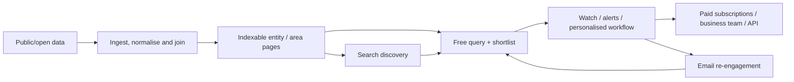

# School Signal — founder, corporate structure, portfolio, commercial intelligence
## Wider competitor investigation and implications for OpenDay

> [!IMPORTANT]
> **Research checkpoint: 24 October 2026.** This is an intelligence **addendum** to [School Signal vs OpenDay — competitor analysis and roadmap](SCHOOL_SIGNAL_COMPETITOR_ANALYSIS_AND_ROADMAP_2026-10-24.md). Facts are cited to their original public sources; business hypotheses are labelled as inference. No claim is made to have inspected private analytics, paid subscriber records, company bank accounts or proprietary software. **This file is research only; no application features have been implemented.**

**Primary website:** [schoolsignal.co.uk](https://www.schoolsignal.co.uk/) (do not conflate with US “School Signals” / schoolsignals.net or schoolsignal.org).  
**Legal operator:** KK London (Designs & Fashion) Limited, UK company no. **12968488**, an *active private limited company*.  
**Founder identified by product:** Alexis Pratsides.  
**Objective:** Understand the people, company, business model, wider app portfolio, financing, distribution and transferable patterns — not merely feature-by-feature website comparison.

---

## 1. Executive judgement: our first analysis looked at the wrong unit

The prior analysis primarily treated School Signal as **a school-directory website**. A better unit of analysis is **an experienced digital marketer/software builder operating a portfolio of data-and-alert products using a shared commercial playbook**. That is a more valuable competitor benchmark.

**Strong evidence:**
1. School Signal publicly identifies **Alexis Pratsides** as its founder and **KK London (Designs & Fashion) Limited**, company **12968488**, as its trading operator. [About](https://www.schoolsignal.co.uk/about), [Terms](https://www.schoolsignal.co.uk/terms).
2. Alexis co-founded **MintTwist**, which **FINN Partners acquired in April 2021**. Independent trade journalism described a 25-person agency with SEO, PPC, web design and social-media expertise; the co-founders became FINN managing partners. [Provoke Media, 6 Apr 2021](https://www.provokemedia.com/latest/article/finn-partners-acquires-digital-marketing-agency-minttwist), [FINN MintTwist](https://www.finnpartners.com/brand/minttwist/).
3. Multiple **active, public, apparently monetisable websites** independently state the *same* operating company number — **School Signal, Planning Signal, TenderSignal, NewcoSignal and CollectionPlnr** — as well as related physical-goods activities. This does **not** prove a shared codebase, profitable revenues, investors or paid customers.
4. Their repeated pattern is **fragmented public data → systematic ingestion/normalisation → indexable detail pages → free search → personally useful alert/workflow → subscription / business export / API / enterprise**.
5. **The company-level financial figures require care.** 2025 *micro-entity accounts are filed*, but School Signal's standalone revenues and profitability **cannot** be read from them. An independent aggregator reports **negative company-wide net assets** as of 2025; without inspecting the original accounts, debt composition or subsequent trading, **do not infer insolvency or business failure**.
6. Marketing **competence is verified from founder history**; School Signal's *actual* audience, CAC, subscriptions, conversions, partnerships and sales remain unverified.

**OpenDay implication:** concentrate on being a trusted, useful **decision and application workflow** and building a systematic public acquisition pipeline. Don't confuse a well-populated national directory with validated user traction. Don't copy competitor listings or proprietary editorial assets.

---

## 2. Founder and professional background (public professional record)

### 2.1 Alexis Pratsides

- Founder of [School Signal](https://www.schoolsignal.co.uk/about); same person identified on [CollectionPlnr About](https://www.collectionplnr.com/about), the [TenderSignal About](https://www.tendersignal.co.uk/about) page and [KK Automotive Art](https://www.kkautomotiveart.com/pages/alexis-pratsides).
- Professional profile: [FINN Partners biography](https://www.finnpartners.com/bio/alexis-pratsides/); [BIMA member biography](https://bima.co.uk/users/alexis-pratsides/); [LinkedIn public professional profile](https://uk.linkedin.com/in/alexispratsides).
- Reports software-engineering training, early **customer-database and ingest/export tooling**, and years designing front ends to interrogate large datasets for marketing users.
- MintTwist was founded in the early 2000s (BIMA says **2002**; formal **MintTwist Limited** company no. **05261672** incorporated in **2004** — product/venture founding and incorporation dates are different).
- FINN confirms it [acquired MintTwist in 2021](https://www.finnpartners.com/brand/minttwist/). [6 Apr 2021 Provoke Media](https://www.provokemedia.com/latest/article/finn-partners-acquires-digital-marketing-agency-minttwist) reported the 25-person agency, clients and resulting partner roles. This is evidence of business-building experience, **not a disclosed acquisition price**.
- The [2023 FINN Outré acquisition release](https://www.finnpartners.com/news-insights/finn-partners-acquires-award-winning-digital-and-creative-design-agency-outre-creative/) describes leadership reporting to Alexis in EMEA. His experience extends beyond a solo hobby site into agency growth and digital marketing operations.
- His reported LinkedIn follower count fluctuates and is **not the audience of School Signal**. Likewise, client brands in a FINN/MintTwist biography are **agency work**, not School Signal endorsements or clients.

> [!TIP]
> **Why it matters:** a person with deep SEO, content, data-ingestion, CRM and performance-marketing experience can create a large public information footprint without a large development team. Their competitive advantage may be *commercial systems thinking*, rather than one particular UI framework or LLM.

### 2.2 Amy Lesley Pratsides and the wider creative business

[Companies House](https://find-and-update.company-information.service.gov.uk/company/12968488/officers) lists **Amy Lesley Pratsides** and Alexis as active directors. Both are [persons with significant control](https://find-and-update.company-information.service.gov.uk/company/12968488/persons-with-significant-control). The disclosed bands are **more than 25% and at most 50% of shares/voting rights for each**; Amy's register entry also records director appointment/removal rights. **These are bands, not an exact cap table or proof of employment on School Signal.**

[KK Designs London’s About page](https://www.kkdesignslondon.com/en-us/pages/about-us) describes a **two-person design/technology studio** with Amy leading creative/marketing and Alexis managing production/software. Its statements support the broader business-operator narrative, but **do not establish who writes or operates School Signal day to day beyond that site's own claim that Alexis built and runs it**.

### 2.3 Former directors / other companies

The operating entity had an earlier company history and one resigned director according to [Companies House filings](https://find-and-update.company-information.service.gov.uk/company/12968488/filing-history). Alexis also had historical company-director appointments beyond MintTwist (e.g. Fanslide); these are **separate legal entities**, and **must not** be depicted as School Signal subsidiaries or current portfolio projects without their own corroboration.

**Privacy boundary:** record only public professional roles, corporate ownership bands, app/public product claims. Do not include children's details, personal lifestyle claims, or residential address as a marketing lead. Companies House correspondence addresses may be public but are not needed to evaluate the product.

---

## 3. Corporate identity, ownership and filings

### 3.1 Verified legal operator

| Item | Public record | Confidence |
|---|---|---|
| Registered entity | KK London (Designs & Fashion) Limited | Official Companies House |
| Company number | **12968488** | Official + School Signal legal footer |
| Status | **Active** | Official |
| Incorporated | **22 October 2020** | Official |
| SIC | **74100 — Specialised design activities** | Official; not a detailed description of present SaaS |
| Latest accounting period filed | **Year ending 31 October 2025**, filed **29 July 2026** | Official [filing history](https://find-and-update.company-information.service.gov.uk/company/12968488/filing-history) |
| Directors | **Alexis Pratsides** (appointed 10 Sep 2021), **Amy Lesley Pratsides** (appointed 15 Apr 2021) | Official [officers](https://find-and-update.company-information.service.gov.uk/company/12968488/officers) |
| PSC | Alexis and Amy; each >25% to ≤50% share/voting bands, Amy director appointment/removal right | Official [PSC register](https://find-and-update.company-information.service.gov.uk/company/12968488/persons-with-significant-control) |
| Data-controller registration | ICO **ZB889879**, registered **16 April 2025**, expiry currently stated **15 April 2027** | Official [ICO](https://ico.org.uk/ESDWebPages/Entry/ZB889879) |
| VAT | School Signal terms state **GB371399079** | Self-published; not independently VAT-database checked |
| Reported users/revenue | Not disclosed | Unknown |

Registered-office information and prior administrative address changes are accessible on Companies House, but are **not evidence about the physical school-product office, headcount, or size of operations**.

### 3.2 Financial accounts: be precise

**Official observation:** the [2025 micro-entity accounts entry](https://find-and-update.company-information.service.gov.uk/company/12968488/filing-history) exists, recorded as filed **29 July 2026**. Original Companies House PDF/XHTML download timed out/failed within this research session. **Its detailed figures were not independently extracted here.**

**Secondary aggregation, not primary-audited by us:** [JARS company financials](https://jars.lt/lt/company/uk/12968488-kk-london-designs-fashion-limited/financials) gives:

| £, except dates | 2024 | 2025 |
|---|---:|---:|
| Total assets | 32,184 | 27,460 |
| Liabilities | 194,793 | 208,035 |
| Equity/net assets | −162,608 | −180,573 |

JARS also shows prior years; its 2023 table appears to contain a **sign/formatting inconsistency**, so do not extrapolate trends without the original accounts. Another provider, [CompaniesInTheUK](https://www.companiesintheuk.co.uk/ltd/kk-london-designs-fashion), still reflects older figures and presents a stale current-director list including a resigned director: **secondary directories lag**.

**Interpretation limits:**
- Negative net assets **do not establish bankruptcy, insolvency, inability to trade, or absence of customers**, since timing, loans and financing matter.
- These are **consolidated at the one operating company level** (not a separately disclosed School Signal product P&L).
- Micro-entity filings typically omit public revenue/profit disclosure. **Turnover, subscribers, gross margins, advertising spend, ARR, valuation and current cash flow remain unknown.**
- If accounting provenance is required, retrieve the original 2025 Companies House micro accounts and check whether creditors include related-party/director funding; do not publish an accusation or conclusion from a third-party summary.

### 3.3 A historical legal-page mismatch — evidence hygiene example

Current [School Signal terms](https://www.schoolsignal.co.uk/terms) identify **12968488**. However, an older legal page on [KK Automotive Art](https://www.kkautomotiveart.com/pages/terms) calls the operation by a related business name but cites company number **09990187** and an older VAT number/address.

The **official company register** currently identifies [09990187](https://find-and-update.company-information.service.gov.uk/company/09990187) as **Incrementum Consulta Limited**, formerly **KK Designs London Limited** among other names. **This is a separate company-number identity**, not the same registration as School Signal.

**Do not infer motive.** The most conservative conclusion is *older/legacy site terms have not been reconciled with the newer operation*. Importantly for OpenDay, include footer/terms/legal-identity consistency checks in a general release audit.

---

## 4. Mapped business and product portfolio

Only classify a project as operated by company **12968488** when its **own publicly visible legal page explicitly says so**.

| Product / domain | Direct company evidence | Core customer job | Advertised data reach | Public pricing or monetisation |
|---|---|---|---|---|
| [School Signal](https://www.schoolsignal.co.uk/) | [Terms](https://www.schoolsignal.co.uk/terms) | Find/compare/apply to schools, open days and policy understanding | **30,816** schools advertised | Free; Pro **£9/month inc VAT**; [Enterprise](https://www.schoolsignal.co.uk/enterprise) **from £299/month** annual contract |
| [Planning Signal](https://www.planningsignal.co.uk/) | [API licence](https://www.planningsignal.co.uk/api-terms) | Track local planning and produce trades/architect leads | **380+** councils, **2.1m** applications advertised | Free; [Research](https://www.planningsignal.co.uk/pricing) **£29/month**; leads and API products |
| [TenderSignal](https://www.tendersignal.co.uk/) | [API terms](https://www.tendersignal.co.uk/api-terms) | Find tenders, receive business matches, track bids | **600+** sources, **1.1m** tenders advertised | [Pro](https://www.tendersignal.co.uk/pricing) **£39/month + VAT**, business teams **£99–£349/month + VAT** |
| [NewcoSignal](https://www.newcosignal.co.uk/) | [API terms](https://www.newcosignal.co.uk/api-terms) | Prospect new and growing companies | **5.7m** existing companies advertised | Free; Pro **£39/month + VAT**; Business **£99/month + VAT** |
| [CollectionPlnr](https://www.collectionplnr.com/) | [Terms](https://www.collectionplnr.com/terms) | Catalogue collectibles, find gaps and estimate market value | Millions of catalogued collectibles advertised | [Starter](https://www.collectionplnr.com/pricing) **$5/month**, Pro **$12/month** |
| [KK Designs London](https://www.kkdesignslondon.com/) / [KK Automotive Art](https://www.kkautomotiveart.com/) | [About](https://www.kkdesignslondon.com/en-us/pages/about-us) and current [delivery page](https://www.kkautomotiveart.com/pages/delivery) | Original print/design and make-to-order consumer products | Multi-model phone cases, art and accessories | Direct product sales; historic legal-page mismatch above |

**Caution on advertised scale:** 2.1 million planning records, 1.1 million tenders, 5.7 million companies and 30,816 schools are **database inventory claims**, not active users or paid subscribers, and not independently sampled against source inventory in this investigation.

**Caution on organisational structure:** one company operating several brands is **not necessarily a conventional holding group or separate fully staffed subsidiaries**. No ownership of FINN Partners by this company is suggested. An agency acquisition and separate brand ownership are different relationships.

### 4.1 Shared product pattern



This is an **inferred commercial pattern** from the public offerings, **not** an observed shared microservices architecture or proof of a common stack.

### 4.2 Repeatability and risk

**Possible strengths:** reusable thinking, strong data operations, a common freemium model, recurring notifications, public pages, topical content, a potentially shared billing stack, independent first-party data products, strong direct-to-SEO alignment.

**Risks/questions:** a broad product range can compete for a small founder's time; no confirmed user scale; subscription conversion and recurring retention are unknown; public-data products depend on source availability and changes; client support and data accuracy may be labour-intensive. There is **no basis** to label these actual failures without operating evidence.

---

## 5. How the business markets itself

### 5.1 What is visible

| Channel | Public evidence | Signal | What we cannot conclude |
|---|---|---|---|
| Programmatic organic search | [School Signal sitemap](https://www.schoolsignal.co.uk/sitemap), town/LA/school pages, recent inspections, open-day council indexes | Designed to intercept high-intent searches | Google ranking, search impressions and organic visitors unknown |
| Evergreen topical SEO | [Knowledge Hub](https://www.schoolsignal.co.uk/knowledge-hub), 2026 founder-attributed guides | Addresses informational questions and adds internal links | Whether content ranks, converts or is widely read |
| Search freshness | Recent Ofsted, deadlines, news/open-day sections; [homepage](https://www.schoolsignal.co.uk/) | Timely landing hooks | Whether scheduled updates are reliable every day |
| Free tool as distribution | [Estate agent embed](https://www.schoolsignal.co.uk/for-estate-agents), postcode widget, free | A property listing becomes a referral channel | Actual number of embedding agents or referral volumes unknown |
| Freemium conversion | [Pricing](https://www.schoolsignal.co.uk/pricing) | Core discovery free, convenience/advanced research paid | Trial and payment conversion unknown |
| Enterprise sales | [Enterprise page](https://www.schoolsignal.co.uk/enterprise) | API, white-label, MATs, authorities, property developers; from £299/mo | Page says “Who uses” in generic terms; **no named verified customers/contracts** confirmed here |
| Email retention | Monthly newsletter invitation in school directories, follow/alerts | Repeat visits and list growth mechanism | Subscriber count, open/click rates unknown |
| Self-service acquisition | Free school profile claiming, tutor profiles | School/tutor-related supply and B2B funnels | Claimed profiles, paid listings or contracts unknown |
| Founder network | [FINN](https://www.finnpartners.com/bio/alexis-pratsides/), BIMA, LinkedIn | Founder plausibly has sales/PR/SEO expertise and professional contacts | No proof they market School Signal or route traffic to it |
| Ads | Potential know-how through MintTwist/FINN | Founder experienced in paid digital channels | **No observed ad budget or current ad campaign** verified |
| Product instrumentation | [Privacy policy](https://www.schoolsignal.co.uk/privacy) discloses Google Analytics via GTM | Likely collects analytics internally | Neither GTM presence nor a privacy-policy claim provides public audience numbers |

Do not mistake a social-profile presence for a verified School Signal-owned social account. Search results for **“School Signals”** include unrelated US organisations; track **exact domain/company identity** before attributing any post or review.

### 5.2 Deeper interpretation

The particularly instructive architecture is not just “SEO”. It is a **conversion sequence**:

**Answer a public question without registration → show enough trustworthy detail to earn confidence → offer alerts or saved searches → return when something materially changes → charge for complex/time-saving use or license access professionally.**

The pricing ladder is explicit across several products:

| Level | Illustrative public benefits | Price mechanism |
|---|---|---|
| Public | Free directory/data browsing and explanatory guides | Search distribution and repeat discovery |
| Personal free | School favourites; basic tender or company alerts | Registration and opted-in engagement |
| Pro | Commute tools, market prices, AI matching, frequent alerts | £9–£39 monthly depending on product |
| Team/business | Shared workflows, exports, unlimited searches, automation | Approx. £99–£349 per month on tender product |
| Enterprise | API/embeds/data access/SLAs | Negotiated recurring fee |

This **tiering** is a product design lesson. There is **no substantiated claim** all tiers have paying customers.

### 5.3 Technical evidence vs speculation

- Public product pages offer **API**, **webhooks**, integration with **Zapier/Make/n8n**, [Planning Signal MCP terms](https://www.planningsignal.co.uk/api-terms) and documented Stripe billing on [TenderSignal](https://www.tendersignal.co.uk/help/plans-and-billing/invoices-and-vat).
- Those are tangible interface offerings, **not proof** of the internal programming language, cloud provider, database, build pipeline, hosting costs, CI or repository location.
- Server-rendered indexable detail pages and unusually broad directories are **consistent with a data-first content-production strategy**, but we have not verified Next.js/Vercel/Cloudflare, a particular CMS or AI coding assistance.
- If architecture truly matters, run a separate consent-free **public-page technology fingerprint audit** on HTTP response headers, crawl metadata, `robots.txt`, structured data and visible JS bundles **without attempting private interfaces or bypassing restrictions**. Do not treat guesses as facts.

---

## 6. What public finances and user signals can — and cannot — tell us

### 6.1 Evidence grading

| Question | Best source | Current answer |
|---|---|---|
| Is there a real company? | Companies House | **Yes, active 12968488** |
| Who is legally in control? | Companies House officers/PSC | **Alexis and Amy** in disclosed bands |
| Has founder built and exited a business? | Acquirer + independent industry press | **Yes, MintTwist acquired by FINN in 2021**; price unknown |
| Are several products monetisable? | First-party pricing/checkouts | **Pricing tiers exist**, not evidence of purchases |
| Are subscribers paying? | Stripe/management accounts or verified testimonials/contracts | **Unknown** |
| How many visitors per month? | First-party GA4/Search Console or credible 3rd-party panel | **Unknown** |
| Marketing CAC/SEO effectiveness? | Ad platform/Search Console/conversion data | **Unknown** |
| Is School Signal profitable? | Product P&L/billing/support costs | **Unknown** |
| Is the operator solvent? | Up-to-date full financial context and creditor structure | **Cannot infer from net assets alone** |
| Is it venture-backed? | Corporate/investor funding disclosures | **No evidence established**; CollectionPlnr calls itself independent/not venture-backed |
| Are schools paying for placement? | Commercial agreements | The site **states** it does not sell better rankings; untested beyond that |
| Does enterprise already have customers? | Named case studies/contracts/official buyers | **Not independently demonstrated by generic “who uses” text** |

### 6.2 Commercial scenarios are not revenue estimates

For School Signal Pro **£9/month inclusive of VAT**:

| Hypothetical Pro payers | Gross monthly receipts (before refunds, VAT extraction, processing, tax and support) |
|---:|---:|
| 100 | £900 |
| 500 | £4,500 |
| 1,000 | £9,000 |

Two enterprise accounts at the **advertised starting price £299/month** would notionally add £598/month **if contracted and paid**. No such contracts have been verified. Even £100,000 gross subscription receipts would not reveal net profit without churn, refunds, staffing, data refresh and marketing costs.

**Important benchmark:** School choice may have a **short, seasonal, high-intent user lifecycle**. B2B licensing, repeat parent families, early warning alerts, data freshness and organic acquisition can matter disproportionately compared with the headline consumer Pro price.

### 6.3 More useful independent checks for the future

1. **Financial primary filing**: read original 2025 micro accounts image/PDF including creditors and notes, and compare 2024; avoid cash-flow conclusions if not disclosed.
2. **Market visibility**: Search Console is not externally accessible; get *directional* Semrush/Similarweb/Ahrefs data if panel coverage is credible, archive date and caveat.
3. **Historical footprint**: Wayback Machine earliest usable snapshots, first indexed guide dates, domain history, earliest third-party backlinks, product launch announcements.
4. **Social/press**: exact-brand social accounts, founder posts *actually mentioning School Signal*, industry/parent press and verified customer testimonials (vs unrelated “School Signals”).
5. **Customer evidence**: named enterprise schools/MATs/estate agents using embedded widget; independently verify live embeds and permission instead of repeating sales copy.
6. **Sustained quality**: stratified sample 25 events / 20 schools / 5 policy types, monitor corrections and refresh across months.
7. **Commercial conversion**: founder interview or direct request for approximate subscribers/customer classes; no inference from pricing table.

---

## 7. Important consistency issue in the competitor evidence

School Signal's impressive content should be evaluated critically:

- The [School Signal terms](https://www.schoolsignal.co.uk/terms) explicitly acknowledge that catchment predictions are estimates based on school-density, local authority-level admissions data and school type; they **do not necessarily use actual school-level historical offer distance**.
- That sits alongside persuasive public language about “chances of a place”. A **random-ballot** school or selective/faith route is not reducible to distance.
- The previous report documented the **Pinner High 12 November 2026** event as wrongly categorised for generic secondary browsing when it was a **sixth-form** opening. See the upstream school's [Sixth Form Apply page](https://www.pinnerhighschool.org/sixth-form/apply-to-study-with-us/).
- A legal-page company-number mismatch exists across another group brand, though **not established on School Signal's current terms**.

The opportunity for OpenDay is **more rigorous provenance/entry-route quality**, not disparagement or blind copying. A top-level website can be simultaneously impressively built, commercially intelligent and wrong about particular school records.

---

## 8. How we should change OpenDay's strategy as a result

### 8.1 The missing strategic layer is *distribution and commercial operations*

We already asked “what data should we add?” and “how should we present it?”. We also need to answer:

1. **Who is the narrowly defined first customer?** Year 5/6 parents comparing state/grammar/independent routes; local London cluster before all-UK expansion.
2. **What triggers a search visit?** Admission policy, autumn open days, booking slots, latest GCSE/KS2 results, catchment myths, scholarships, upcoming tests.
3. **What keeps users returning?** Real booking opening, verified new open day, an admissions change, a new results release or a family shortlist decision.
4. **How does a school-specific page acquire visitors?** Search-indexed useful profile, unique policy/event facts and date-stamped sources, not just an SPA filter state.
5. **What could legitimately generate income?** Paid family workspaces/export and application planning, institution data quality/licensing, parent-adviser tools, opt-in alerts.
6. **What should remain free?** Official facts, entry eligibility caveats, school-sourced dates and essential access routes; never sell confidence or ranking bias.
7. **What is the data-production cost?** Ingest/refresh, ambiguous school joins, human review of admissions PDFs, breakages and longitudinal storage.
8. **What is the proof of willingness to pay?** Paying pilots, repeat usage and correction confidence, not a price table designed in advance.

### 8.2 A repeatable OpenDay product-platform template

Use across future apps only when validated:

```text
PUBLIC VALUE             ENGAGEMENT             MONETISATION
----------------         ------------------     -----------------------
Official source data ->  Open school profile ->  Advanced workflow
Stable identity      ->  Follow/shortlist    ->  Shared household/adviser
Normalised evidence  ->  Book/event watch    ->  API / embed / exports
Useful guidance      ->  Change alerts      ->  Pro / B2B contract
Indexable page       ->  Return + referral   ->  Outcome tracking
```

**But:** product engineering remains an operational constraint. OpenDay's migration, privacy boundaries, Firebase budget, shared release gate, app version/cache discipline and browser QA must not be discarded for faster page production.

### 8.3 Concrete additional work packages

| ID | Priority | Deliverable | Proof of completion |
|---|---|---|---|
| **OD-BIZ-001** | P0 | Operator/competitor intelligence registry | Founder, company ID, brand list, source URLs, dated reviews and unknown fields |
| **OD-BIZ-002** | P0 | 2025 accounts primary validation | Original Companies House 2025 micro accounts inspected and accounting figures reconciled; no unsupported insolvency label |
| **OD-BIZ-003** | P1 | Public brand-by-brand product/funnel audit | Browse and record a **real free-user experience** on each related product with screenshots, role, CTA, alert flow, paid upsell and exit |
| **OD-BIZ-004** | P1 | Separate traffic/traction evidence study | Archive comparable dated Similarweb/Ahrefs/Semrush visibility where possible; named backlink evidence; no invented MAU |
| **OD-BIZ-005** | P1 | OpenDay searchable content and distribution pilot | 10 source-rich local school/council pages, canonical URLs, sitemaps, search impressions and shortlist conversions |
| **OD-BIZ-006** | P1 | School-event accuracy benchmark | 25 visits across entry routes + 20 source-verified dossiers; critical-error rate dashboard |
| **OD-BIZ-007** | P1 | Reusable **“source to notification”** engine | Dated official-source changes → diff → reliability grade → user-opted alert; duplicate suppression and no firehose |
| **OD-BIZ-008** | P2 | Parent and adviser willingness-to-pay interviews | 5–10 qualitative sessions, concrete workflow/price sensitivity, logged assumptions, no speculative business forecast |
| **OD-BIZ-009** | P2 | Evidence-controlled white-label/embeddable panel | One partner pilot; attribution/legal/privacy review, track referral and corrections |
| **OD-BIZ-010** | P2 | Multi-app data-business operating standards | Shared `SourceRegistry`, provenance, data licences, legal footer, terms consistency and release evidence across Apps |

### 8.4 Specific design opportunities from the wider comparison

- **Build credibility like a product, not an academic spreadsheet**: professional narrative, plain-English explanation, short journey-oriented pages and obvious next actions.
- **Build the business funnel as carefully as the app**: public profile accessible by search, one highly useful action, follow/shortlist, meaningful alerts, returning user.
- **Offer suitable user incentives**: deadline/dates/eligibility remain open; paid plans add work removal, collaboration, printing and export, not “secret admission odds”.
- **Test before scaling**: verification errors or too many abandoned school cards mean more indexed pages could magnify misinformation, not value.

---

## 9. Evidence and source register

### Primary identity / director / finance
- [UK Companies House: KK London (Designs & Fashion) Limited, 12968488](https://find-and-update.company-information.service.gov.uk/company/12968488)
- [Filing history: official 2025 micro accounts dated 29 Jul 2026](https://find-and-update.company-information.service.gov.uk/company/12968488/filing-history)
- [Current and former directors](https://find-and-update.company-information.service.gov.uk/company/12968488/officers)
- [Current/previous persons with significant control and ownership bands](https://find-and-update.company-information.service.gov.uk/company/12968488/persons-with-significant-control)
- [ICO data controller record ZB889879](https://ico.org.uk/ESDWebPages/Entry/ZB889879)
- [JARS secondary 2025/2024 balance sheet summary **unverified against source PDF**](https://jars.lt/lt/company/uk/12968488-kk-london-designs-fashion-limited/financials)
- [Legacy company 09990187 — separate present registration, historic KK Designs London name](https://find-and-update.company-information.service.gov.uk/company/09990187)

### Founder and prior business
- [School Signal “Who runs”](https://www.schoolsignal.co.uk/about)
- [FINN Partners Alexis biography](https://www.finnpartners.com/bio/alexis-pratsides/)
- [BIMA Alexis profile](https://bima.co.uk/users/alexis-pratsides/)
- [FINN confirms MintTwist acquisition](https://www.finnpartners.com/brand/minttwist/)
- [Independent acquisition reporting — Provoke Media, 6 Apr 2021](https://www.provokemedia.com/latest/article/finn-partners-acquires-digital-marketing-agency-minttwist)
- [FINN 2023 Outré Creative acquisition and leadership](https://www.finnpartners.com/news-insights/finn-partners-acquires-award-winning-digital-and-creative-design-agency-outre-creative/)
- [Public professional LinkedIn profile](https://uk.linkedin.com/in/alexispratsides/)

### Operated-product first-party proof
- [School Signal Terms](https://www.schoolsignal.co.uk/terms), [Pricing](https://www.schoolsignal.co.uk/pricing), [Enterprise](https://www.schoolsignal.co.uk/enterprise), [Estate Agent Embed](https://www.schoolsignal.co.uk/for-estate-agents), [Sitemap](https://www.schoolsignal.co.uk/sitemap), [Knowledge Hub](https://www.schoolsignal.co.uk/knowledge-hub), [Privacy/analytics](https://www.schoolsignal.co.uk/privacy).
- [Planning Signal API legal operator](https://www.planningsignal.co.uk/api-terms), [Pricing](https://www.planningsignal.co.uk/pricing).
- [TenderSignal legal operator](https://www.tendersignal.co.uk/api-terms), [Founder](https://www.tendersignal.co.uk/about), [Pricing](https://www.tendersignal.co.uk/pricing), [Billing help](https://www.tendersignal.co.uk/help/plans-and-billing/invoices-and-vat).
- [NewcoSignal operator](https://www.newcosignal.co.uk/api-terms), [Pricing home page](https://www.newcosignal.co.uk/).
- [CollectionPlnr operator and founder](https://www.collectionplnr.com/about), [Terms](https://www.collectionplnr.com/terms), [Pricing](https://www.collectionplnr.com/pricing).
- [KK Designs London roles and business](https://www.kkdesignslondon.com/en-us/pages/about-us), [KK Automotive current delivery page](https://www.kkautomotiveart.com/pages/delivery) and [historic terms discrepancy](https://www.kkautomotiveart.com/pages/terms).

---

## 10. Handoff: what to investigate next

**High-return verification work:**
1. Primary financial filing (2025) and directors' relevant notes **without speculating beyond disclosed details**.
2. Date-stamped technical and SEO footprint study of **all five data products**: entity-page count, sitemap patterns, JSON-LD, visible public endpoints, email/alerts/value proposition, accessibility and web performance.
3. Exact first-index / first-active snapshots, archive and backlinks of School Signal; **domain registration date is not product launch date**.
4. Independent **named enterprise client** or real estate-widget embed evidence; avoid treating “Who uses” copy as proof.
5. 2–3 free account journeys across the brands, documenting actual interaction; **do not create accounts or accept paid terms without user consent**.
6. Bring the most valuable **cross-product repeated patterns** back into an OpenDay implementation experiment, with baseline, outcome and shared app release gate.

**Research conclusions are durable; all further tasks remain unimplemented.** This report should be updated as dated addenda, not silently overwritten with later promotional claims. Document generated for internal competitive analysis from publicly available sources, not for contact targeting or personal profiling.
